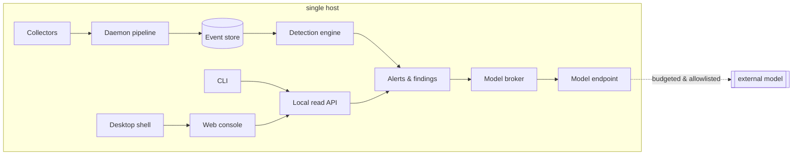

# AIDriven NetDefense

**网域智防** — a local-first network defense agent for a single host.

**Language / 语言**：**[English](README.md)** · **[中文](README.zh-CN.md)**


> **Status: pre-release source drop.** The tree is at `0.0.1-rc.6` (pre-release candidate).
> No installer, no signed binary and no release artifact is distributed from this repository;
> release artifacts are built and published outside this source repository. Treat everything
> here as work in progress, not as a finished product.

Author: **PT-dove**

---

## 1. What this is

AIDriven NetDefense is a single-host defense agent. It collects host telemetry, evaluates it
against detection rules, stores findings and alerts as evidence, and — only through a
governed model-analysis path — produces a conclusion a human can act on.

The product is deliberately narrow. It is not a SIEM, not a gateway appliance, and not a
cloud service. **One machine, one user, local data.**

### Key capabilities

| Capability | Where | Notes |
|---|---|---|
| Host telemetry collection | `packages/collectors` | Common / Linux / Windows collectors |
| Rule-based detection | `packages/detection` | Accountable evidence: every `count` maps to real event rows |
| Durable event store | `packages/event-store` | Dedupe keys, transactional ingest, crash recovery |
| Governed model analysis | `apps/model-broker` | Budgeted, allowlisted endpoints, fail-closed |
| Local read API | `apps/daemon` | Health, alerts, analysis, status |
| CLI client | `apps/cli` | Command-line access to the local API |
| Web console | `apps/console` | Static files, no build step, no framework, no CDN |
| Desktop shell | `apps/desktop` | Python shell that supervises the daemon and hosts the console |
| Response **planning** | `apps/response-helper` | Produces plans only; execution is disabled |

### Design stance

Four rules shape the codebase; most of the unusual decisions in it follow from these:

1. **Data stays on the host.** Collected evidence and analysis requests are not shipped to a
   hosted service. Any model endpoint is explicitly registered by the local operator, with a
   per-endpoint budget and a frozen resolution of scheme/host/port/path.
2. **Evidence is accountable.** An alert's `count` must be explainable by event rows that
   actually exist in storage. Code paths that could produce a count without a traceable row
   are treated as defects, not as acceptable approximations.
3. **Fail closed.** When a budget is exhausted, a signature does not verify, a policy field is
   missing, or an integrity check cannot be performed, the operation is refused. Degradation
   is surfaced as an explicit `degraded` state, never as a silent downgrade.
4. **A human approves action.** The response side produces plans. It does not execute.

---

## 2. Architecture



The daemon exposes a **loopback-only** API (`127.0.0.1`). The web console is static and is
served by the daemon or the desktop shell. The model broker is the **only** place that can
talk to an external endpoint, and only for endpoints the local operator explicitly registered.

---

## 3. Directory layout

```
apps/            agent, CLI, console, desktop shell, model broker, harness worker
packages/        contracts, collectors, detection, event-store, policy, response-policy
plugins/         defense profile and defense tools
deploy/          runtime staging, systemd unit templates, Windows installer prototype
scripts/         build, gate and release tooling
tests/           unit, contract, integration, e2e, packaging, security-corpus and soak suites
docs/design/     architecture, plugin system, harness contract, test & acceptance criteria
docs/product/    product-facing descriptions, including an explicit gap list
```

---

## 4. Quick start

Requirements:

- **Node.js** `>= 24.9.0` (see `.nvmrc`)
- **npm** `>= 11.6.0 < 12.0.0` — enforced by `scripts/check-node-version.mjs`, which fails closed
- **Python 3.11+** only for the optional desktop shell (`apps/desktop`)

```bash
npm ci
npm test          # full gated suite, per-work-package
npm run check     # test suite + SBOM check + license check
```

Useful subsets:

```bash
npm run test:wp0              # repository baseline, harness manifest, toolchain gate
npm run test:wp1-event-store  # storage, dedupe, transactional ingest, recovery
npm run test:wp5-daemon       # pipeline, API, health
npm run test:wp6-model-broker # admission, budgets, credentials, request shaping
npm run sbom:check            # CycloneDX SBOM consistency
npm run license:check         # third-party license policy
```

The optional desktop shell:

```bash
python apps/desktop/main.py
```

No network access is required to build or to run the test suites; the model endpoint used by
tests is a loopback stub.

---

## 5. Capability boundaries — what this does **not** do

This section exists because the honest description of a security tool is mostly a list of
what it cannot do yet. The following are **absent or unverified today**:

| Area | Current state |
|---|---|
| **Signed installer / uninstaller** | A Windows installer prototype and a transaction engine live under `deploy/windows/installer/`. There is no signed `.exe`, no MSI/MSIX, no packaged release. |
| **Code signing** | No certificate, no signature chain, no `signtool` invocation. |
| **Cross-platform validation** | Only `win32-x64` has actually been run. Linux and win32-arm64 paths exist in code but carry no runtime evidence. Do not assume they work. |
| **Response execution** | `apps/response-helper` produces plans only. Execution is disabled in code; every action reports `dry_run_only`. |
| **Approval API** | The local API has a closed set of read/probe routes. There is no approval or response endpoint, so "human approval" exists in the data model and policy layer only. |
| **Bundled detection rules** | No rule pack ships with the repository. Detection needs a rule pack supplied by the operator. |
| **Real-host collection** | Collectors are exercised against mock and virtual sources. Continuous collection on a real host, with measured RSS/CPU, has not been demonstrated. |
| **Model credentials** | Tests use loopback stubs and test tokens. Real credential handling, rotation and revocation are unobserved. |
| **Auto-update** | Designed in ADR-0011, which is **not accepted** and therefore not published here. No updater exists. |
| **MCP control plane / gateway edition** | Out of scope. No implementation, not planned for the first version. |
| **Performance and soak numbers** | Bench and soak suites exist but are not wired into any gate. No published figures. |

If you need any of the above, this repository is not the tool you are looking for — yet.

---

## 6. Documentation

| Start here | Why |
|---|---|
| `docs/product/01-overview.md` | What the product is, in product language |
| `docs/product/04-gaps.md` | The gap list — read this before believing any capability claim |
| `docs/design/SOFTWARE_DESIGN.md` | Architecture, data model, storage, budgets |
| `docs/design/TEST_AND_ACCEPTANCE.md` | Acceptance criteria, including data-boundary invariants |

---

## 7. Roadmap

- `0.0.1` — the first complete version, frozen only after functionality, install/upgrade,
  multi-OS validation, signing and the release gate all pass.
- Afterwards: `0.0.x` patches, `0.x.0` features, `1.0.0` stable.

Version numbers are not raised early to imply that a release happened. The current tree is
`0.0.1-rc.6` (pre-release candidate).

---

## 8. Contributing

This is a single-author project in active development. If you want to report a bug or propose
a change, open an issue first and describe the problem before sending code. There is no formal
contribution guide yet; `CONTRIBUTING.md` will be added when the project stabilizes.

---

## 9. License

Apache License 2.0 — see `LICENSE`. Copyright 2026 PT-dove.

Third-party attributions, including the obligations for the weak-copyleft components in the
dependency tree, are recorded in `THIRD_PARTY_NOTICES`. The machine-readable component
inventory is `sbom.cdx.json`. Security reports: see `SECURITY.md`.
