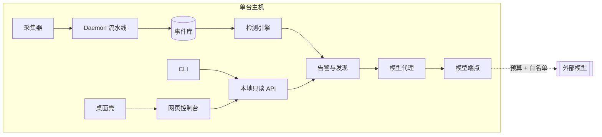

# AIDriven NetDefense（网域智防）

**网域智防** — 一台机器、一个用户的本地优先网络防御代理。

**语言 / Language**：**[English](README.md)** · **[中文](README.zh-CN.md)**


> **状态：预发布源码快照。** 树内版本为 `0.0.1-rc.6`（预发布候选）。
> 本仓库**不分发**任何安装包、签名二进制或发布产物；发布产物在仓库之外单独构建与发布。
> 这里的一切都视为进行中的工作，不是成品。

作者：**PT-dove**

---

## 1. 这是什么

网域智防是一台主机上的本地防御代理：采集主机遥测，按规则判定，把发现与告警作为证据落到
本地事件库，并且只通过受治理的模型分析通道，产出一条可供人判断的结论。

它刻意做得窄：**不是 SIEM、不是网关设备、不是云服务。一台机器、一个用户、本地数据。**

### 核心能力

| 能力 | 位置 | 说明 |
|---|---|---|
| 主机遥测采集 | `packages/collectors` | 公共 / Linux / Windows 三套采集器 |
| 基于规则的检测 | `packages/detection` | 证据可追责：每个 `count` 都要能对应真实事件行 |
| 持久化事件库 | `packages/event-store` | 去重键、事务写入、崩溃恢复 |
| 受治理的模型分析 | `apps/model-broker` | 预算、端点白名单、失败即拒绝 |
| 本地只读 API | `apps/daemon` | 健康、告警、分析、状态 |
| CLI 客户端 | `apps/cli` | 命令行访问本地 API |
| 网页控制台 | `apps/console` | 纯静态文件，无构建、无框架、无 CDN |
| 桌面壳 | `apps/desktop` | Python 外壳，托管 daemon 与控制台 |
| 响应**规划** | `apps/response-helper` | 只产出方案；执行在代码里是关闭的 |

### 设计立场

四条原则贯穿全仓，多数看起来"反直觉"的决定都源于它们：

1. **数据不出本机** —— 采集到的证据与分析请求不送到托管服务；任何模型端点都由本机操作者
   显式登记，每个端点单独计预算，协议/主机/端口/路径在解析后冻结。
2. **证据可追责** —— 告警的 `count` 必须能对应到库里真实存在的事件行；"有计数但无行可查"
   的代码路径一律按缺陷处理，而不是"可接受的近似"。
3. **失败即拒绝** —— 预算耗尽、签名不符、策略字段缺失、完整性校验无法完成，一律拒绝；
   降级以显式 `degraded` 状态暴露，绝不静默降级。
4. **动作要人批** —— 响应侧只产出方案，不执行动作。

---

## 2. 架构



Daemon 只暴露**回环（`127.0.0.1`）**接口；网页控制台是静态的，由 daemon 或桌面壳提供。
模型代理是**唯一**能对外联网的地方，而且只能访问本机操作者显式登记的端点。

---

## 3. 目录结构

```
apps/            代理、CLI、控制台、桌面壳、模型代理、harness worker
packages/        契约、采集器、检测、事件库、策略、响应策略
plugins/         防御 profile 与防御工具
deploy/          运行时暂存、systemd 单元模板、Windows 安装器原型
scripts/         构建、门禁、发布工具
tests/           单元、契约、集成、e2e、打包、安全语料、浸泡套件
docs/design/     架构、插件系统、harness 契约、测试与验收标准
docs/product/    面向产品的描述，含显式的缺口清单
```

---

## 4. 快速开始

环境要求：

- **Node.js** `>= 24.9.0`（见 `.nvmrc`）
- **npm** `>= 11.6.0 < 12.0.0` —— 由 `scripts/check-node-version.mjs` 强制，失败即拒绝
- **Python 3.11+** 仅在需要可选桌面壳（`apps/desktop`）时才要

```bash
npm ci
npm test          # 全量门禁套件，按包运行
npm run check     # 测试套件 + SBOM 检查 + 许可检查
```

常用子集：

```bash
npm run test:wp0              # 仓库基线、harness 清单、工具链门禁
npm run test:wp1-event-store  # 存储、去重、事务写入、恢复
npm run test:wp5-daemon       # 流水线、API、健康
npm run test:wp6-model-broker # 准入、预算、凭据、请求整形
npm run sbom:check            # CycloneDX SBOM 一致性
npm run license:check         # 第三方许可策略
```

可选桌面壳：

```bash
python apps/desktop/main.py
```

构建与运行测试套件都不需要联网；测试用的模型端点是回环桩。

---

## 5. 能力边界 —— 先说不做什么

这一节之所以存在，是因为对安全工具最诚实的描述，主要是一份"它现在还做不到什么"的清单：

| 领域 | 当前状态 |
|---|---|
| **签名安装包 / 卸载器** | `deploy/windows/installer/` 下有安装器原型与事务引擎；没有签名 `.exe`、没有 MSI/MSIX、没有打包发布 |
| **代码签名** | 无证书、无签名链、未调用 `signtool` |
| **跨平台验证** | 只有 `win32-x64` 真正跑过；Linux 与 win32-arm64 的代码路径存在但无运行时证据，不要假设它们可用 |
| **响应执行** | `apps/response-helper` 只产出计划；执行在代码里关闭，每个动作都报 `dry_run_only` |
| **审批接口** | 本地 API 是封闭的只读/探针路由集合；没有审批或响应端点，"人工审批"只存在于数据模型与策略层 |
| **内置检测规则** | 仓库不附带任何规则包；检测需要操作者自备规则包 |
| **真实主机采集** | 采集器只对 mock 与虚拟源验证过；在真实主机上的连续采集（含实测 RSS/CPU）未演示 |
| **模型凭据** | 测试用回环桩与测试 token；真实凭据的托管、轮换、吊销未观察 |
| **自动更新** | 只在 ADR-0011 设计稿里，该 ADR **未通过**，因此这里没有发布任何更新器 |
| **MCP 控制面 / 网关版** | 不在范围内，无实现，第一版也不计划 |
| **性能与浸泡数据** | 有 bench 与 soak 套件，但未接入任何门禁；无公开数字 |

如果上面任何一条是你需要的，那这个仓库暂时不是你要找的工具。

---

## 6. 文档

| 从这里开始 | 为什么 |
|---|---|
| `docs/product/01-overview.md` | 用产品语言说清这是什么 |
| `docs/product/04-gaps.md` | 缺口清单 —— 在相信任何能力声明前先读它 |
| `docs/design/SOFTWARE_DESIGN.md` | 架构、数据模型、存储、预算 |
| `docs/design/TEST_AND_ACCEPTANCE.md` | 验收标准，含数据边界不变量 |

---

## 7. 路线图

- `0.0.1` —— 第一个完整版本，只有在功能、安装/升级、多 OS 验证、签名与发布门禁全部通过后
  才冻结。
- 之后：`0.0.x` 补丁、`0.x.0` 功能、`1.0.0` 稳定版。

版本号不会为了暗示"已发布"而提前抬升。当前树内版本为 `0.0.1-rc.6`（预发布候选）。

---

## 8. 参与贡献

这是一个单人作者、活跃开发中的项目。要报 bug 或提改动，请先开 issue 描述问题，再谈代码。
目前还没有正式的贡献指南；待项目稳定后补 `CONTRIBUTING.md`。

---

## 9. 许可

Apache License 2.0 —— 见 `LICENSE`。版权 2026 PT-dove。

第三方归属（含弱 copyleft 组件的义务）记录在 `THIRD_PARTY_NOTICES`；机器可读的组件清单是
`sbom.cdx.json`。安全报告见 `SECURITY.md`。
