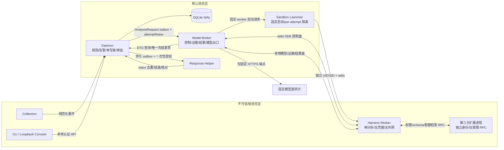

# 软件设计说明书

- 项目代号：AegisHarness
- 版本：v1.3
- 状态：已定稿（插件扩展第三轮独立复核 GO）
- 文档负责人：PT-dove
- 对应计划：DEVELOPMENT_PLAN v1.2（已定稿）
- 上游：DeepSeek Harness `0.2.2-alpha.2`，提交 `ce7073d51254c26cd63b22a60835b8f948deb447`

## 1. 目的与范围

本说明书定义 Windows 11 x64、Ubuntu 22.04/24.04 LTS x86_64、Debian 12 x86_64 上单机防御软件的实现合同。核心是本地持续采集、确定性检测、告警、存储与人工管理；Harness 只提供按需分析。设计不包括业务代码、云控制面、内核驱动、全自动响应或对任意 VM 快照回滚的自动识别。

### 1.1 设计不变量

1. daemon 不导入 Harness，不同步等待模型；移除 Harness 后核心功能完整。
2. model-broker 独占提供方凭据和外网；worker 只能访问本地 broker。
3. 原始证据不进入 worker；所有出域字段经 allowlist、脱敏与大小检查。
4. daemon 是唯一数据库写者和审批权威；其他进程经授权 IPC 请求写入。
5. 报告不能执行；Proposal 不能绕过审批；执行助手独立验证一次性授权。
6. 模型与响应分别失败关闭，采集单项失败只降级对应能力。
7. 任一动作×OS 未通过门禁即从构建、策略和 IPC/API 同步裁剪。
8. 支持受控 dsh 风格插件；第三方代码在每 analysis 的独立扩展进程中经受限 RPC 运行，无 worker token/Session、核心、审批、预算、响应或网络权限。

## 2. 总体架构

### 2.1 进程与账户

| 组件 | Linux | Windows | 权限与写入范围 |
|---|---|---|---|
| daemon | `aegis-core` 用户 | 专用低权限服务账户 | 自有 DB、配置读取；无模型外网 |
| collectors | 默认同核心低权限；可选最小特权采集服务 | 同核心或独立采集服务 | 只读声明来源，无审批/执行权限 |
| model-broker | `aegis-broker` | 独立服务账户 | 提供方凭据、仅固定 443 出口，无原始证据库访问 |
| plugin-manager | 本地插件管理员触发 | 本地插件管理员触发 | 只管理受保护包/overlay，不执行插件或安装脚本 |
| sandbox-launcher | 独立最小特权服务 | 独立最小特权服务 | 只启动签名固定 worker；分配 per-attempt 身份与隔离，无通用命令 |
| harness-worker | 每 attempt 独立 UID + namespaces/cgroup | 每 attempt 独立 AppContainer/SID + restricted token/Job Object | 仅自有 cwd/Session；无提供方凭据/外网，跨 worker 不可读 |
| response-helper | 按动作独立服务/助手 | 按动作独立服务/助手 | 仅声明动作；无通用 shell/文件 API |
| console | 以交互用户运行或核心回环 API | 同左 | 无直接 DB/执行助手访问 |

安装器可以提权创建账户、ACL 和服务，运行期组件不得修改安装 ACL。程序、模块、插件、规则和服务配置目录仅管理员可写。worker 使用独立 HOME/TMP/DSH_HOME，环境变量清理，不继承用户代理配置。

sandbox-launcher 只接受 broker 的固定启动合同：签名 worker 路径、profile/config digest、attempt_id、资源上限和 stdio 句柄，不接受任意可执行路径或参数。Linux 为每 attempt 分配独立数值 UID/GID，建立最小只读 mount namespace、私有 PID/proc 视图、no_new_privs、capabilities 全降、seccomp 与 per-UID 默认拒绝 nftables 规则，仅放行 broker 回环端口；目录 ACL 绑定该 UID。Windows 为每 attempt 建独立 AppContainer profile/capability SID、restricted token、Job Object 和目录 ACL，以 WFP 默认拒绝外发并仅允许 broker 回环端点，限制跨 worker 进程句柄。token 仅注入目标 worker，其他身份不可读。

任一 UID/SID、namespace/ACL、进程隔离或出口要素无法建立时，launcher 必须在 worker 获得摘要、证据或模型请求前失败关闭。cgroup/Job Object 只用于资源与整树回收，不被当作文件或网络隔离。

## 3. 模块与目录映射

- `apps/daemon`：调度、规则、告警、审批、API、单写者与健康，不负责进程重启。
- `apps/model-broker`：分析调度、数据出域检查、token 账本请求、提供方传输、usage 对账。
- `apps/plugin-manager`：dsh 插件检查、安装、启停、权限与受控 overlay，不执行插件代码。
- `apps/harness-worker`：最小 dsh SDK JSON-RPC 宿主、分析 Session、内置防御工具和 extension-bridge；第三方代码在独立扩展进程。
- `apps/response-helper`：动作适配器、对象身份绑定、执行核对和恢复清单。
- `packages/contracts`：封闭 Schema、规范化、版本协商。
- `packages/ipc`：Unix socket/命名管道、对端身份、授权、nonce/TTL、大小和重放保护。
- `packages/event-store`：事务、outbox/inbox、迁移、备份、保留、审计。
- `packages/policy`：预算、动作、保护对象、故障关闭。
- `plugins/dsh-defense-profile`：显式最小树与签名清单。
- `plugins/dsh-defense-tools`：`evidence.get_summary` 和 `analysis.submit_result`。

## 4. 数据合同

### 4.1 通用规则

JSON 仅允许 UTF-8、无重复键、安全边界 unknown fields 一律拒绝；最大嵌套 6、对象键 128、数组 256、单字符串 16KiB（原始证据专用字段例外，最大 256KiB）、IPC 消息 1MiB。整数限制在 IEEE-754 安全整数内。ID 使用随机 UUID；时间同时保存 RFC3339 UTC 与来源接收序列，间隔使用单调时钟。

路径由平台适配器解析为规范化目标身份，原始路径只本地展示。显示、审批、执行使用同一规范化 DTO 的 SHA-256。`schemaVersion` 采用 `major.minor`：major 不同拒绝；minor 新增可选字段只用于非安全边界，安全合同仍按封闭版本协商。

### 4.2 主要对象

| 对象 | 必备字段与约束 |
|---|---|
| TelemetryEvent | event_id、stable_source_id、collector_instance_id、source_generation、boot_id、native_record_id?、source_seq、observed_at、received_at、type、severity、payload、integrity |
| Finding/Alert | rule_id/rule_version、event_ids、fingerprint、severity、first/last_seen、count、status、evidence_refs |
| EvidenceRef | 高熵不可遍历 ID、analysis_id、alert_id、allowed_fields、expires_at、max_bytes、digest |
| AnalysisRequest | analysis_id、alert_id、budget_class、summary_dto、created_at、idempotency_key、epoch |
| ModelRequest | request_id、analysis_id、request_seq、serialized_digest、input_upper、output_limit、reserved_at、usage/state |
| AnalysisReport | analysis_id、summary、confidence、evidence_ids、limitations、model_meta；仅展示 |
| ResponseProposal | proposal_id、analysis_id、action_id、normalized_target、justification_evidence、risk、expires_at；仅待审批 |
| Approval | approval_id、proposal_digest、policy_version、target_digest、approver_identity、nonce、issued/expires、epoch、state |
| ExecutionGrant | execution_id、approval_id、action/parameters/target digest、nonce、not_before/expires、epoch、signature |
| AuditEvent | sequence、timestamp、actor、action、object_digest、previous_digest、payload_digest、HMAC |

`AnalysisReport` 与 `ResponseProposal` 无继承或隐式转换。模型自由文本、Markdown 或 JSON 字符串不能成为 ExecutionGrant。

## 5. 采集设计

### 5.1 首版来源矩阵

| 来源 | Windows | Linux | 默认机制/间隔 | 降级与已知盲区 |
|---|---|---|---|---|
| 进程 | Toolhelp32 快照；Security 4688 可选 | procfs 扫描 | 5 秒；事件源可用时辅助 | 短寿进程可漏；其他用户字段受权限/hidepid 限制 |
| 网络 | GetExtendedTcp/UdpTable | procfs net/tcp(6)、udp(6) | 5 秒 | 短寿连接可漏；socket 与进程关联可不完整 |
| 文件元数据 | ReadDirectoryChangesW + 对账 | inotify + 对账 | 事件驱动，60 秒对账 | 队列溢出产生缺口；默认不读文件内容 |
| 安全/认证日志 | EvtSubscribe/EvtQuery 可访问通道 | journald JSON；可访问 auth.log | 跟随 + 轮转检查 | Security 日志、journal/auth 权限不足即降级 |
| 服务持久化 | SCM 只读枚举 | systemd D-Bus/单元元数据 | 60 秒 | 只覆盖声明来源 |
| 任务/启动持久化 | Task Scheduler 只读；Run 键 | cron 声明路径 | 60 秒 | 不宣称覆盖全部持久化技术 |

每源保存 lifecycle、last_success、last_event、last_error、last_gap、权限说明。轮询源超过 2 个采集周期未推进即为 stale；事件驱动源每 30 秒执行独立订阅健康探测并记录 last_valid_subscription，长期零业务事件不等于故障。文件采集只记录元数据、哈希（配置允许时）与变化，不默认采集内容。

文件监控最多 32 个根目录；Linux 最多 8192 个递归 inotify watch，Windows 最多 256 个目录句柄。每根缓冲 64KiB、总缓冲 4MiB；超限拒绝新增根或明确降级，不静默停止递归覆盖。高优先级 10% 预留同时适用于队列条数与字节数。

### 5.2 身份、缺口与背压

稳定来源/通道身份与采集进程实例分离：`stable_source_id` 标识逻辑来源，`collector_instance_id` 仅用于健康诊断，不参与原生事件去重。Windows 唯一键为通道+日志代次+record ID；journald 使用 cursor；轮转文件使用稳定文件标识/来源代次+序列；无原生 ID 时使用持久游标、来源代次、序列与重叠重放窗口。清空日志或记录 ID 重用必须递增 source_generation。采集器读取后未提交即重启时，按持久游标重叠重放，同一稳定键幂等去重。

每源默认 100 事件/秒、全局 1,000 事件/秒准入；单原始事件 256KiB。队列 100,000 且总字节 256MiB，高优先级预留 10%。去重/关联状态每源最多 50,000 指纹、全局 200,000，TTL 24 小时；超限时合并低优先级并生成资源缺口，不无限分配内存。所有丢弃/合并记录来源、区间、原因和计数。

## 6. 检测与告警

规则包包含规则 ID、版本、签名、条件、窗口、严重度、字段限制和测试样例。规则执行只允许声明运算符，不执行脚本。默认单规则单批 50ms CPU 上限，超限禁用该规则并告警，其他规则继续。

指纹基于截断前规范化事件字段。告警 15 分钟聚合；保存期间最高严重度，升级需跨更高等级且经过 5 分钟升级冷却。每指纹每小时最多 4 次分析请求，全局预算仍为最终限制。告警状态为 new/acknowledged/resolved/suppressed；抑制不删除原始事件。

## 7. 存储与事务

### 7.1 表与单写者

表：`telemetry_event`、`finding`、`alert`、`evidence`、`analysis_request`、`model_request_ledger`、`response_proposal`、`approval`、`execution`、`recovery_manifest`、`audit_event`、`capability_state`、`meta`。只有 daemon 打开可写 SQLite；console、broker、worker、helper 经 IPC 请求事务。

SQLite 使用 WAL、foreign_keys、busy_timeout、参数化语句。默认 DB 2GiB，80% 高水位、90% 临界水位；普通事件 30 天、告警/审计 180 天。容量冲突依次清理低价值遥测、过期分析 Session 索引、已聚合低级别事件；不擅自删除高严重度告警。预分配独立 16MiB 应急日志。

### 7.2 必须原子的事务

- **T1 摄入**：事件 + Finding/Alert + AnalysisRequest outbox + AuditEvent。
- **T2 预算**：检查持久时间高水位、UTC 日账 + 在途预留 + 单分析上限，原子递增 request_seq 并插入 request_id 唯一的 reserved 记录。
- **T3a 批准**：校验 pending/ttl/epoch，Approval pending→approved，Execution 新建 approved，写执行意图与审计。
- **T3b 授权/投递准备**：Approval approved→consumed，Execution approved→dispatch_pending，写同一 execution_id/attempt_id 的 Grant 与持久执行 outbox；nonce 只在此事务消费一次。
- **T3c 交付/接受**：outbox 标记 dispatched；helper 以 execution_id+attempt_id inbox 去重并接受后写 accepted，随后条件迁移 executing。旧 owner/lease 不能提交新状态。
- **T4 结算**：execution_id + result_seq 唯一，更新执行/恢复清单/审计；重复结果为幂等确认而非再次执行。
- **T5 分析完成**：仅在 analysis_id+attempt_id+owner lease 匹配且非终态时，同一事务持久化 Report/可选 Proposal、Analysis 终态与审计；broker complete/fail 都只是事务输入，不是第二状态权威。

备份使用 SQLite online backup/checkpoint，禁止直接复制活跃 WAL 文件。迁移前备份，meta 记录 schema 与最低读取二进制版本；旧二进制拒绝新 schema。损坏库隔离为只读证据，核心进入明确降级，不自动删除重建。

磁盘预算：主 DB 2GiB、WAL 达 512MiB 触发 checkpoint 且硬上限 1GiB、单份在线备份 2GiB、Session 256MiB、临时文件 256MiB、应急日志 16MiB；安装指南要求数据卷至少 8GiB 可用。达到各自上限即按故障矩阵降级，不以其他目录剩余空间假装无限容量。

### 7.3 恢复 epoch

每次产品编排备份/恢复生成随机新 epoch，审批、授权、租约和预算预留均绑定；恢复后旧授权/attempt 失效，但财务债务不失效。epoch 切换将所有旧 reserved/sent/unknown 保留为跨 epoch 债务，无法证明未发送的 reserved/sent 原子转 unknown；T2 汇总所有 epoch 的未结上界。若平台提供 VMGenID 或外部单调锚点，也纳入 epoch。任意 VM 快照回滚无可靠本地识别保证，文档禁止把其作为安全恢复机制；epoch 不匹配或无法确定时模型与响应失败关闭并等待管理员登记。

## 8. Harness 最小集成

### 8.1 自定义 profile

不使用 base 或 sdk-minimal 默认组合。精确直接插件、必需宿主服务、stdio 控制序列和禁止项见 `docs/design/HARNESS_PROFILE_CONTRACT.md`。该合同保留 SDK 必需的 fs/workingDirectory/sessionProjections 服务，但不向模型注册对应工具，并由 OS 沙箱限制到每分析空 cwd 与自有 Session。

WP0 必须核对包、插件、运行时服务和模型面/有效配置四层清单，包含传递依赖、inject 提供者、精确版本与哈希。清单由构建生成但须独立复核，不能自证。任何额外高危实现、缺失必需服务、未批准 patch 或 stdout logger 均禁止 worker 启动；验证未通过则 Agent 功能整体裁剪，核心继续交付。上下文超限即失败，不自动压缩；网络结果未知不自动重试。

dsh 风格插件的安装、权限、生命周期和 Effective Manifest 见 `docs/design/PLUGIN_SYSTEM.md`；固定 dsh/Cordis 兼容 API 与 RPC 见 `docs/design/PLUGIN_COMPATIBILITY_PROFILE.md`。第三方扩展代码在每 analysis 的独立扩展进程中经 extension-bridge RPC 运行，不与内置 worker 共享 token、Session 或 Cordis 对象；插件包格式兼容不等于允许其申请的高危权限。

### 8.2 分析流程

1. daemon 将最小摘要写入 outbox，状态 queued；无告警不创建请求。
2. broker 以原子 claim 取得 analysis_id+attempt_id+owner lease，执行字段/大小/预算检查并冻结本次 Effective Plugin Manifest；sandbox-launcher 为该 attempt 创建独立 OS 身份、完整沙箱、单次 broker token 和空 cwd/HOME/TMP/Session。隔离或插件清单未就绪不得启动分析。
3. broker 经 stdio 执行 initialize→session/prompt→session/wait；worker 的模型、证据和结果工具全部只连接 broker。broker 从 token 推导 analysis/attempt，不信任请求体自报身份。
4. 证据调用由 broker 携 analysis_id+attempt_id+EvidenceRef 请求 daemon；daemon 校验 TTL/字段/owner 后返回脱敏 DTO，broker 再执行出域检查和 64KiB 限制。
5. `analysis.submit_result` 只到 broker。broker 以 attempt/lease 调用 daemon T5，原子持久化 Report/可选 Proposal、终态与审计；重复 complete 返回现状，fail 不得覆盖已提交结果，迟到 attempt 拒绝。
6. 一 worker 一 analysis，完成/失败/超时立即撤销 token、关闭整树并清除专用目录。stdio EOF/半关闭按取消处理；90 秒墙钟到期强制回收，迟到结果无效。

### 8.3 数据分级

- D0：公开版本、规则 ID、计数、状态，可出域。
- D1：规范化时间、事件类型、平台、脱敏网络/进程元数据，仅 allowlist 出域。
- D2：原始命令行、日志正文、用户名、路径、文件内容，默认不出域；只有显式授权的派生字段可出域。
- D3：API Key、token、cookie、私钥、密码及已知秘密存储，禁采/禁出域。

不宣称通用秘密识别能发现所有编码秘密；无法确定 DTO 合规时禁止外发。Session、WAL、备份、导出、临时文件、转储和隔离副本均纳入数据清单与清除流程。

## 9. Token 与资源控制

### 9.1 请求账本算法

每次真实 provider 请求都必须：

1. 由 broker 生成 request_id/analysis_id/attempt_id/request_seq，序列化最终请求并计算 digest。
2. 用已验证的提供方 tokenizer 加上按最终消息、角色、工具与特殊标记序列计算的开销得到 `input_upper`；无法证明时采用完整序列化请求 UTF-8 字节数加经上游合同验证的标记上界，仍无法证明则拒绝。
3. `output_limit = min(分析剩余, 日剩余, 2000)`，同时写入 provider `max_tokens`。
4. T2 原子检查日预算、分析预算、在途预留与 request_seq<=3，插入 reserved。余额公式分别为 `settled_actual + Σ(reserved/sent/unknown 的上界) + 新上界 <= 预算`；不足不发请求。
5. 持久迁移仅允许 reserved→sent→settled，或 reserved/sent→unknown；仅证明尚未发送才能 reserved→void。唯一键 `(analysis_id,request_seq)` 防重复计数。
6. 发送后按 usage 结算。无 usage、结果未知或崩溃按上界扣款；禁用自动重试，人工重试创建新 request_id/seq 并重新计账。新 epoch 不释放旧 unknown 债务。

daemon 持久化 last_trusted_utc、last_utc_day、boot_id 与时间不确定状态。当前 UTC 早于高水位、账桶回退，或 wall/mono 偏差超过 5 分钟，即禁止新请求并等待管理员登记；重启先以持久高水位校验，再建立新单调基线。正常向前推进才允许新 UTC 日账。未知请求只能经提供方查询结算或保守按上界结清，不能因重启/跨日自动释放。

预算是**本地请求准入硬上限**，不冒充提供方账户账单硬上限；提供方若偏离协议或 tokenizer 上界，最终请求可能产生结算差异，必须显示并立即停止后续请求。需要绝对账单上限时另配置提供方端限额。

默认：单分析 12k 输入/2k 输出/3 请求；UTC 每日 30k 输入/6k 输出；最多 2 个分析并发。预算与配置只能由本地管理员修改，Agent 无权限。

### 9.2 熔断与生命周期

熔断 closed/open/half-open 状态全局持久化。网络、鉴权、配额、schema、本地工具分类计数；连续 5 次可重试类失败打开 15 分钟，鉴权/配额立即打开并需管理员处理。半开仅 1 个分析。子任务退避 1/5/15/60/300 秒，10 分钟 5 次失败后暂停自动重启。

worker 单分析 90 秒、工具结果 64KiB、分析输出 1MiB、RSS 1GiB 硬上限，禁止非必要子进程；结果提交或失败后立即退出，不存在跨分析空闲复用。Linux cgroup/KillMode 与 Windows Job Object 必须回收整树。

## 10. 审批与执行状态机

### 10.1 状态

- Analysis：queued → dispatched → running → succeeded/degraded/failed/cancelled。
- Approval：proposed → pending → approved/rejected/expired；approved → consumed；任何未消费项可 invalidated。
- Execution：approved → dispatch_pending → dispatched → accepted → executing → succeeded/failed/result_unknown；result_unknown → reconciling → succeeded/failed/manual_required。
- Rollback：not_required/pending/running/succeeded/failed/manual_required。

只有 daemon 可提交状态迁移，helper 提交带 execution_id/attempt_id/lease/序列的结果证据。dispatch_pending 由持久 outbox 重发同一 Grant；dispatched 未收到接受证据时可用同一 execution/attempt 幂等查询或重投，helper inbox 去重，绝不生成新动作。accepted 未开始先核对 helper；executing 后失去结果一律 result_unknown。Rollback 使用同样的 outbox/inbox/attempt 状态机。租约过期只触发核对，不自动再次执行；外部副作用与 SQLite 不在同一事务，因此副作用前必须写执行意图。

### 10.2 授权与目标绑定

角色默认拒绝：viewer 只读；analyst 可请求分析但不能审批；responder 可审批响应；budget-admin 只能调整预算；admin 管理本地授权。OS 组分别为 `aegis-viewers/analysts/responders/budget-admins/admins`，安装时不自动把所有管理员加入 responders。console 初始凭据仅发给其 OS 交互用户，daemon 将会话映射到该 OS 身份并实时核对组/显式 allowlist。

Approval 绑定 approver OS 身份、responder 角色快照、再认证时间、Proposal digest、策略版本、目标 digest、nonce、TTL、epoch。T3a 在同一事务再次检查当前角色、5 分钟内再认证和策略版本；T3b 原子消费后生成短期签名 Grant。helper 独立验证签名、动作 allowlist、参数、目标、时间、epoch 和 nonce，不因 IPC 来自 daemon 就省略校验。

进程使用 OS 句柄及创建时间/可执行身份绑定，不允许检查后按裸 PID 终止。进程终止不可逆，UI 需额外确认。文件基于安全文件/父目录句柄并处理链接、reparse point、ADS、挂载和路径别名；不能保证对象同一性则该动作×OS 不发布。网络与文件只管理带本产品 operation_id 的对象。

helper 在解析并绑定目标后、任何网络/文件副作用前，必须把独立恢复清单与恢复日志原子写入并 fsync；包含 recovery_id、execution_id、attempt_id、operation_id、目标 digest、对象身份、真实前状态、预期后状态和 prepared/executing。未完成该边界不得调用 OS 动作；副作用后记录实际后状态。前置阶段崩溃时 rescue 先核对，只能恢复确认由本产品改变的同一对象，无法确认是否发生副作用则 manual_required，不得盲目恢复。

### 10.3 独立应急恢复

`cli rescue` 不连接普通执行授权 API，只由本机 OS 管理员交互运行。它读取管理员可写保护、独立于 daemon DB 的恢复清单，只能恢复本产品拥有的网络规则或隔离对象，不能终止新进程、隔离新目标或接受自由命令。

每项清单包含 recovery_id、execution_id、attempt_id、operation_id、规范化目标 digest、动作特有对象身份、前后状态和持久状态。独立恢复日志采用 prepared→executing→applied→restoring→restored/manual_required 原子迁移，重复 recovery_id 只返回/核对原结果。文件恢复前以安全文件与父目录句柄核对隔离对象，目标路径已存在替代对象时拒绝覆盖；网络恢复核对自己 operation_id 和当前规则身份，不覆盖用户新建规则。restoring 中崩溃只核对，不盲目再次恢复。

恢复写独立预分配应急审计；该审计不可用时仍允许“恢复自有对象”以解除锁定，但必须写原生系统事件/stderr 最佳努力记录，且禁止任何新处置。低权限组件、Agent 和普通 console 无 rescue 权限。

## 11. IPC 与本地 API

| 端点 | 调用方 | 方法 | 授权 |
|---|---|---|---|
| sdk-control | broker→worker stdio | initialize/session.prompt/session.wait/shutdown | 单 attempt 进程，半关闭即取消 |
| evidence | worker→broker→daemon | evidence.get_summary | analysis+attempt+EvidenceRef+字段/TTL |
| analysis | broker↔daemon | claim/complete/fail/heartbeat | broker 身份+attempt+lease，T5 唯一完成事务 |
| model/tools | worker→broker | Messages、evidence.get_summary、analysis.submit_result | 单次 token 推导 analysis/attempt，预算与对象授权 |
| approval | console/CLI→daemon | create/approve/reject | 交互用户会话+再认证+CSRF |
| execution | daemon↔helper | dispatch/result/reconcile | 服务身份+签名 Grant+lease |
| rescue | 本机管理员→独立清单 | restore-owned-object | OS 管理员，无网络端点 |

Linux 使用 Unix socket ACL + SO_PEERCRED；Windows 使用命名管道 ACL + 客户端身份验证。所有消息还有版本、request_id、序列、nonce、TTL、1MiB 上限和重放缓存。禁止任意 SQL、任意路径和通用命令方法。

Console 默认 `127.0.0.1`/`::1`，随机高熵凭据由本机安全初始化生成，禁止 URL token。实施 Host/Origin allowlist、DNS rebinding 防护、SameSite/CSRF、严格 CSP、WebSocket 同源与认证、会话过期/撤销、敏感操作再认证和登录限速。所有不可信文本纯文本渲染，禁止原始 HTML、危险 URI、远程资源和 ANSI 控制序列。

## 12. 故障关闭矩阵

| 故障 | Agent | 响应 | 核心 |
|---|---|---|---|
| 模型网络/凭据/配额 | 停止并保留本地告警 | 不受影响 | 继续 |
| 预算/usage/epoch 不确定 | 禁止新请求 | 不受影响 | 继续 |
| 脱敏/schema/guard/broker 异常 | 禁止外发 | Proposal 不进入审批 | 继续 |
| 审批/策略/目标/审计不确定 | 可保留报告 | 禁止新响应 | 继续并降级提示 |
| DB 只读/损坏 | 禁止新分析 | 禁止新响应，允许限定 rescue | 最佳努力采集/带外健康，明确未持久化 |
| 单采集源失败 | 不受影响 | 不受影响 | 标降级/缺口，其他源继续 |
| 磁盘满 | 有界排队后停止新分析 | 禁止新响应 | 清理自有低价值数据、应急通知、恢复后补缺口 |
| worker hung/崩溃 | 超时回收/熔断 | 无直接副作用 | 继续 |

## 13. 服务、资源与发布

系统服务管理器独占核心/broker/helper 重启；daemon 仅暴露 readiness/liveness。安装、升级、回滚、卸载分别处理数据保留/清除，不自动打开 UI 或更新。签名验证包含信任根、签名者、撤销、最低安全版本；校验和只用于完整性，不单独建立信任。

参考环境 4vCPU/8GiB、50 规则（30 条件/15 阈值/5 关联）、100 万历史事件。预热 30 分钟、初始队列 0。正常/安静负载 5 事件/秒，大小分布 50% 1KiB、45% 4KiB、5% 32KiB；来源比例进程 30%、网络 30%、文件 20%、日志 15%、持久化 5%。每 5 分钟注入一个高严重度探针，延迟从 daemon received_at 到告警提交且本地通知入队。24h 核心+采集器+本地 API 平均 CPU < 单核 1%，合计 RSS 目标 <250MiB、硬门槛 <400MiB；broker/worker 单独计量。正常负载高严重度告警 p95 <5s、p99 <15s。

风暴为同尺寸分布 500 事件/秒 15 分钟，分别验证队列条数与字节上限、双维度 10% 高优先级预留和缺口账。记录 CPU 峰值窗口、最大 RSS、句柄、队列、来源新鲜度及 DB/WAL/备份/Session/tmp 各自磁盘占用。

发布物含 Apache-2.0、上游 MIT/第三方声明、SBOM、签名、构建来源、权限/隐私/覆盖和已知限制。任意 VM 快照回滚、root/SYSTEM/内核被控、物理磁盘彻底失效不在安全保证内。

## 14. 验证与实施约束

验收用例、需求映射与门禁见 `docs/design/TEST_AND_ACCEPTANCE.md`。所有测试使用临时目录和无害数据，真实目录快照前后零变化。安全变异门禁先证明原始实现全绿，再逐个杀死 allowlist、guard、脱敏、预算、审批、epoch、目标复核被移除的变异体。

实施另开对话。主会话只调度与验收；实现和独立审查子代理使用不同上下文。WP0 的实际 Harness 插件树证明是第一道阻断门禁；不得在未通过时继续 Agent 功能集成。
